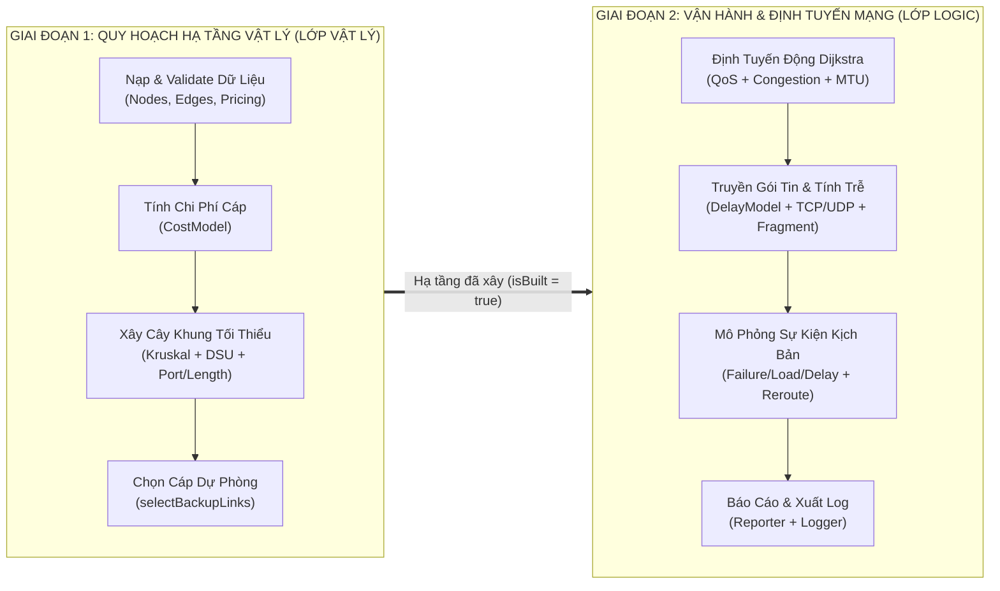

# BÁO CÁO ĐÁNH GIÁ, ĐỐI CHIẾU VÀ NHẬN XÉT TỔNG THỂ DỰ ÁN PBL2
**Tên đề tài:** Thiết kế & Mô phỏng Hệ thống Mạng Viễn thông (Network Topology Design & Routing Simulator)  
**Phạm vi rà soát:** Toàn bộ tài liệu kiến trúc (`README.md`, `docs/architecture/system_architecture.md`, `docs/Tong_Hop_Toan Bo_Du An_Thuc Te.md`, `docs/formulas/calculation_formulas.md`), toàn bộ mã nguồn Backend (`include/`, `src/`, `main.cpp`), dữ liệu (`data/`) và Giao diện đồ họa (`main_gui.cpp`).

---

## PHẦN 1: TỔNG HỢP NỘI DUNG CỐT LÕI CỦA CHƯƠNG TRÌNH (CORE CONCEPT)

Từ các tài liệu gốc và kiến trúc 11 bước, bản chất cốt lõi của đồ án PBL2 là giải quyết **bài toán kép trong kỹ thuật mạng viễn thông**, gồm 2 giai đoạn nối tiếp và phụ thuộc chặt chẽ vào nhau:



1. **Bài toán 1 – Quy hoạch hạ tầng cáp tối ưu (Physical Topology Design):**
   - Từ tập hợp các tuyến cáp khảo sát ban đầu (`edges.txt`), loại bỏ các cáp vi phạm điều kiện vật lý tĩnh (như cáp đồng `Edge #8: R2-H1` dài $130\text{m}$ vượt ngưỡng tối đa $100\text{m} \to \text{TOO\_LONG}$).
   - Dùng thuật toán **Kruskal + DSU** có ràng buộc số cổng (`usedPorts < totalPorts`) để chọn ra $V - 1$ tuyến cáp tạo thành **Cây khung nhỏ nhất (MST)** có chi phí lắp đặt thấp nhất (`isBuilt = true`).
   - Vì MST thuần túy không có chu trình nên hễ đứt 1 cáp là mạng bị chia cắt. Do đó hệ thống chạy tiếp thuật toán **`selectBackupLinks()`** để mua thêm $K$ tuyến **Cáp dự phòng (Backup Links)** bảo vệ các nhánh trọng yếu (`isBuilt = true, isBackup = true`), tạo ra phương án cân bằng giữa chi phí và độ tin cậy (Task B2.4: So sánh *Build All* vs *MST* vs *MST + Backup*).

2. **Bài toán 2 – Định tuyến động & Mô phỏng truyền gói tin theo kịch bản (Logical Routing & Discrete Simulation):**
   - Trên hạ tầng cáp đã lắp đặt, thuật toán **Dijkstra** tìm đường đi ngắn nhất cho từng gói tin dựa trên hàm trọng số động **`RoutingCost`**: kết hợp ưu tiên dịch vụ **QoS** (`REAL_TIME`, `BULK_DATA`, `CONTROL`), hệ số phạt tắc nghẽn **`congestionPenalty(load)`**, và phạt phân mảnh **MTU**.
   - **Simulator & DelayModel** tính toán 4 thành phần độ trễ chuẩn viễn thông (*Transmission, Propagation, Processing, Queuing*), kiểm tra cờ chống phân mảnh (`DF - Don't Fragment`), tính số mảnh băm nhỏ (`Fragmentation`), cộng phụ phí bắt tay 3 bước của giao thức **TCP (`newConnection`)**, và cập nhật tải trọng đường truyền (`updateNetworkState`).
   - Khi có kịch bản sự kiện theo thời gian (`LINK_DOWN`, `LINK_UP`, `LOAD_UPDATE`, `DELAY_UPDATE`), mạng tự động tính toán lại lộ trình (**Dynamic Reroute**) sang cáp dự phòng hoặc báo **DROP** nếu bị cô lập.

---

## PHẦN 2: ĐỐI CHIẾU LOGIC – NHỮNG ĐIỂM PHI LOGIC & BẤT NHẤT HIỆN TẠI

Khi đối chiếu giữa **triết lý thiết kế trong Backend (`src/`)** và **cách thể hiện trên Giao diện đồ họa (`main_gui.cpp`)**, có **5 điểm phi logic / mâu thuẫn nghiệp vụ** cần đặc biệt lưu ý:

### 1. [Nghiêm trọng nhất] Lớp Logic trên GUI đang định tuyến trên "Cáp chưa xây" và cả "Cáp vi phạm vật lý" (`onlyBuilt = false`)
* **Quy chuẩn ở Backend (`Dijkstra.h`, `Simulator.cpp`, `Reporter.cpp`):**
  Trong `Dijkstra.h` (dòng 34–38) đã định nghĩa rất rõ:
  > *"onlyBuilt: khi true, CHỈ đi trên các cạnh đã `isBuilt = true` (đã được Kruskal chọn xây, tức MST + Backup). Đây là chế độ đúng cho việc định tuyến gói tin thật, vì gói tin chỉ có thể đi trên dây cáp ĐÃ LẮP, không phải trên toàn bộ dây ứng viên."*
* **Thực tế đang diễn ra trong `main_gui.cpp`:**
  - Tại hàm `recordKruskalSteps()` (dòng 454–456), chương trình copy sang biến tạm `Graph tempG = g;` rồi mới gọi `buildMST(tempG)` và `selectBackupLinks(tempG)`. Do đó trên đồ thị chính `workingGraph`, tất cả các cạnh đều có `isBuilt == false`!
  - Tại `updateRoutingPath()` (dòng 478), GUI gọi `dijkstra(g, src, dst, qosPkt, false)` (tức `onlyBuilt = false`).
* **Hệ quả phi logic:**
  1. **Gói tin đi qua cả sợi cáp bị loại do quá dài (`TOO_LONG`):** Nếu bạn chọn định tuyến từ **R2 $\to$ H1**, ở Lớp Vật Lý (Kruskal) sợi cáp đồng `Edge #8 (R2 - H1, 130m)` đã bị loại bỏ màu đỏ vì vượt giới hạn cáp đồng $100\text{m}$. Thế nhưng khi chuyển sang Lớp Logic (Routing), gói tin lại **đi thẳng qua sợi cáp 130m bất hợp lệ đó**!
  2. **Gói tin đi qua sợi cáp đắt đỏ không được xây (`Edge #5: R1 - R4, 9098 ĐV`):** Trong quy hoạch MST + Backup, cáp `R1 - R4` ($1200\text{m}$, địa hình đồi núi phức tạp, giá $9098\text{ ĐV}$) bị loại bỏ vì quá đắt. Nhưng ở Lớp Logic, khi chọn `R1 -> R4` với chế độ `Hop` hoặc khi đứt cáp khác, gói tin vẫn vô tư chạy qua sợi dây chưa hề được lắp đặt này.
  3. **Làm đứt mạch liên kết giữa 2 chế độ trên GUI:** Kết quả của nút `"Chạy MST"` hoàn toàn không có tác động gì đến việc chọn đường của `"Lớp Logic (Routing)"`.

---

### 2. Ba nơi gọi `dijkstra()` trên cùng một giao diện nhưng dùng 3 hàm trọng số khác nhau
Trên `main_gui.cpp`, thuật toán Dijkstra được gọi ở 3 vị trí nhưng thiếu tính đồng bộ:
1. **Thanh công cụ Lớp Logic (`updateRoutingPath` - dòng 478):** Gọi `dijkstra(g, src, dst, qosPkt, false)` $\to$ Dùng trọng số động **`RoutingCost`** (tính bằng giây, có xét QoS, tải `currentLoad`, và MTU).
2. **Bảng định tuyến khi rê chuột vào trạm (`RoutingHover` Tooltip - dòng 1360):** Gọi `dijkstra(workingGraph, appState.hoveredNodeId, destId)` không truyền gói tin $\to$ Mặc định dùng **`lengthWeight`** (chỉ tính bằng **mét chiều dài vật lý**, hoàn toàn phớt lờ QoS, phớt lờ tải tắc nghẽn `currentLoad` và băng thông!).
3. **Khi gói tin đang di chuyển gặp cáp đứt (`Dynamic Reroute` - dòng 798):** Cũng gọi `dijkstra(workingGraph, u, pkt.destNode)` theo **`lengthWeight` (mét)** thay vì trọng số QoS của gói tin đang truyền.

* **Hệ quả phi logic:** Khi chạy kịch bản **Tắc nghẽn (`congestion.txt`)**, tải trên cáp `R1 - R3` tăng lên $95\% - 100\%$. Đường màu cam trên Canvas (dùng `RoutingCost`) lập tức đổi hướng sang `R1 -> R2 -> R4` để né nghẽn; nhưng khi bạn **rê chuột vào R1 để xem Bảng định tuyến (Tooltip)**, bảng định tuyến vẫn báo Next-Hop đi theo đường cũ vì `lengthWeight` chỉ nhìn vào số mét mà không hề biết đường đó đang bị tắc nghẽn!

---

### 3. Đặt tên nút `"Delay / Tải / Hop"` trên GUI chưa phản ánh đúng bản chất 3 loại gói tin `PacketType` và không làm thay đổi kết quả ở trạng thái mặc định
* **Bản chất trong Backend (`Config.h`, `RoutingCost.cpp`):**
  Hệ thống phân loại 3 nhóm gói tin dịch vụ:
  - `REAL_TIME`: `{wTrans = 1.0, wProp = 1.0, wQueue = 4.0}` (Rất nhạy cảm với trễ hàng đợi/tắc nghẽn).
  - `BULK_DATA`: `{wTrans = 2.0, wProp = 1.0, wQueue = 2.0}` (Ưu tiên băng thông lớn để giảm `dTrans`).
  - `CONTROL`: `{wTrans = 1.0, wProp = 1.0, wQueue = 1.0}` (Trọng số cân bằng).
* **Bất cập trên GUI (`main_gui.cpp` dòng 1034–1038 & 1086–1092):**
  - Giao diện đổi tên 3 loại này thành `"Delay"`, `"Tải"`, `"Hop"` kèm chú thích `"[Hop: Ưu tiên ít chặng nhất]"`. Thực tế `CONTROL` vẫn tính tổng độ trễ $(1.0 \cdot d_{\text{trans}} + 1.0 \cdot d_{\text{prop}} + 1.0 \cdot d_{\text{queue}})$ chứ **không hề dùng `unitWeight` (đếm số chặng hop = 1)**.
  - Hơn nữa, ở đồ thị ban đầu khi chưa có sự kiện tắc nghẽn (`currentLoad = 0.0`), mọi cạnh cáp quang đều có `queueDelay = 0.001s` bằng nhau. Vì vậy đối với đa số các cặp trạm (như `R1 -> H1`, `R1 -> R2`), việc bấm chuyển qua lại giữa 3 nút `Delay`, `Tải`, `Hop` **không làm thay đổi lộ trình và cũng không làm thay đổi con số độ trễ hiển thị** (bởi độ trễ hiển thị là độ trễ vật lý thực tế tính từ `Simulator::sendPacket`, chỉ khi nào lộ trình đi qua các cạnh có băng thông khác nhau như `1Gbps` vs `10Gbps` thì đổi nút mới đổi đường).

---

### 4. Chuyển bước trong "Mô Phỏng Kịch Bản" không tự động cập nhật lại Đường định tuyến và MST trên màn hình
* **Vấn đề trong `main_gui.cpp` (dòng 911, 923, 1264, 1275, 1280, 1321):**
  Khi người dùng chọn một kịch bản hoặc bấm nút `[Tiến bước >>]`, `[<< Lùi bước]`, hoặc click chọn một sự kiện trong danh sách (ví dụ `LINK_DOWN` hoặc `LOAD_UPDATE`), hàm `applyScenarioToStep()` chỉ sửa trạng thái trên `workingGraph` nhưng **không gọi lại `updateRoutingPath()` và `recordKruskalSteps()`**.
* **Hệ quả:** Nếu người dùng đang mở Lớp Logic xem đường đi `R1 -> R4` rồi bấm chạy từng bước kịch bản `congestion.txt` hoặc `failure.txt`, đường định tuyến màu cam và thông số độ trễ trên thẻ nổi **vẫn giữ nguyên kết quả cũ**, không tự động bẻ lái hay cập nhật độ trễ mới ngay tại bước đó (phải đợi người dùng click lại vào nút QoS hoặc Node thì mới cập nhật).

---

### 5. Hàm xem trước lộ trình (`updateRoutingPath`) vô tình làm biến đổi ngầm tải trọng mạng (`currentLoad`)
* Trong `Simulator.cpp` (dòng 116): Hàm `Simulator::sendPacket(pkt, path, graph)` vừa tính độ trễ vừa gọi `updateNetworkState(edge, dTrans)` để **cộng thêm tải trọng vào `edge.currentLoad`** của đồ thị.
* Trong `main_gui.cpp` (dòng 479): Mỗi khi người dùng chỉ mới **click chọn Node đích hoặc đổi nút radio QoS** (chưa bấm `"Gửi Gói Tin"`), hàm `updateRoutingPath()` đã gọi `Simulator::sendPacket(qosPkt, appState.currentPath, workingGraph)`. Điều này làm tải của các cạnh trên `workingGraph` bị thay đổi ngầm sau mỗi cú click xem thử, đi ngược lại nguyên lý cô lập trạng thái của Task B4.2.

---

## PHẦN 3: NHỮNG PHẦN CODE ĐÃ VIẾT NHƯNG KHÔNG ĐƯỢC ỨNG DỤNG VÀO GIAO DIỆN (UNUSED / HIDDEN FEATURES)

Đây là những phần bạn đã đầu tư viết rất bài bản trong Backend và dữ liệu, nhưng hiện tại đang bị "lãng phí" vì giao diện `main_gui.cpp` chưa khai thác hoặc bỏ qua:

| STT | Thành phần / Module | Nơi đã viết | Tình trạng trên Giao diện (`main_gui.cpp`) | Hệ quả thực tế |
| :--- | :--- | :--- | :--- | :--- |
| **1** | **Bộ dữ liệu gói tin `data/packets.txt`** (`Packet #0: 500B UDP DF`, `Packet #1: 3000B TCP Frag`) | `IOManager::loadPackets` (được gọi ở dòng 519 `main_gui.cpp`) | Đọc vào vector `packets` rồi **bỏ trống không dùng ở bất kỳ đâu**. GUI tự tạo gói tin giả `1500B UDP`. | Người dùng không thể chọn truyền thử các gói tin mẫu đã thiết kế trong `packets.txt`. |
| **2** | **Kiểm tra MTU, Chặn gói DF & Phân mảnh (`Fragmentation`)** (Task B3.6, B3.7 & Kịch bản 4 `mtu.txt`) | `DelayModel::calcFragmentCount`, `RoutingCost.cpp`, `Simulator.cpp` | Do GUI khóa cứng gói tin `1500B` và mọi cáp đều có `MTU = 1500`, nên `fragments` luôn bằng `1`. Kịch bản 4 (`mtu.txt`) khi chọn trên GUI chỉ hiện *"(Kịch bản không có sự kiện động)"*. | Toàn bộ tính năng băm gói tin (`3000B -> 3 mảnh`), phạt phân mảnh và báo lỗi `DF_BLOCKED_BY_MTU` không bao giờ xuất hiện trên GUI. |
| **3** | **Phụ phí bắt tay 3 bước TCP (`TCP 3-Way Handshake`)** (Task B3.8) | `DelayModel::calcProtocolOverhead`, `Simulator.cpp` (dòng 120) | Do gói tin trên GUI gán cứng `Protocol::UDP` và `newConnection = false`, nhánh tính RTT của TCP không bao giờ chạy. | Không thể hiện được sự khác biệt độ trễ giữa giao thức `TCP` và `UDP` trên giao diện. |
| **4** | **Module phân tích cáp dự phòng `Reliability`** (`findBackupForTreeEdge`, `findAllBackupsForTreeEdge`) | `include/Reliability.h`, `src/Reliability.cpp` (135 dòng code hoàn chỉnh) | **Không được `#include` và không được gọi ở bất kỳ file nào** trong toàn bộ dự án (cả `main.cpp` lẫn `main_gui.cpp`). | Module viết xong hoàn toàn bị bỏ quên (Dead Code), dù rất hữu ích để giải thích lý do cáp Backup cứu nhánh cây bị đứt. |
| **5** | **Xuất nhật ký mô phỏng `Logger` & các hàm báo cáo sự cố `Reporter`** | `src/Logger.cpp`, `src/Reporter.cpp` (`printPacketRouteReport`, `printFailureRecoveryReport`) | `main_gui.cpp` có `#include "Reporter.h"` nhưng không gọi hàm nào. Khi chạy kịch bản trên GUI không xuất file log ra `data/logs/` và không hiện bảng đối chiếu `OLD PATH -> FAILED EDGE -> NEW PATH`. | Các báo cáo phân tích sâu chỉ có ở bản Console (`main.cpp`) mà chưa hiện diện trên GUI. |
| **6** | **Cơ chế chụp trạng thái mạng `NetworkSnapshot`** (Task B4.1, B4.2) | `Simulator::snapshotNetworkState` (`src/Simulator.cpp` dòng 13 & 267) | Trong `Simulator.cpp` dòng 267, biến `NetworkSnapshot snap` được tạo ra nhưng **không được đọc hay sử dụng ở bất kỳ dòng nào tiếp theo**. | Hàm tồn tại để đáp ứng checklist task nhưng thực tế chưa tham gia vào luồng xử lý. |

---

## PHẦN 4: NHỮNG PHẦN DƯ THỪA, RƯỜM RÀ TRONG CODE & TÀI LIỆU

### 1. Trùng lặp thuật toán (Vi phạm nguyên tắc DRY trong `main_gui.cpp`)
* **Viết lặp lại thuật toán Kruskal trong `main_gui.cpp`:**
  Hàm `recordKruskalSteps()` (dòng 412–456 của `main_gui.cpp`) tự viết lại toàn bộ quy trình: khởi tạo `DSU`, sắp xếp cạnh bằng `compareEdges`, gọi `checkEdge`, gộp `dsu.unite`, tăng `usedPorts`... giống hệt 100% với hàm `buildMST()` trong `src/Kruskal.cpp`. Ngay sau vòng lặp đó (dòng 455), nó lại gọi tiếp `buildMST()` một lần nữa!
* **Nhánh điều kiện `if / else` giống hệt nhau (dòng 1825–1830 của `main_gui.cpp`):**
  ```cpp
  if (isCurvedDiagonal(u, v)) {
      if (u == 1) {
          pktPos = evalQuadraticBezier(a, r2r4Ctrl, b, pkt.progress);
      } else {
          pktPos = evalQuadraticBezier(a, r2r4Ctrl, b, pkt.progress);
      }
  }
  ```
  Hai nhánh `if (u == 1)` và `else` thực hiện cùng một phép tính y hệt nhau, làm code rườm rà không cần thiết.
* **Biến trạng thái dư thừa:**
  - `AppState::hasBuiltMST` (dòng 101 `main_gui.cpp`): Khai báo nhưng không bao giờ được sử dụng.
  - `#include "Reporter.h"` (dòng 29 `main_gui.cpp`): Include nhưng không gọi hàm nào.
  - `NetworkSnapshot snap` (dòng 267 `src/Simulator.cpp`): Khởi tạo nhưng không dùng (`unused variable`).

### 2. Hard-code ID nút và cạnh trong xử lý đồ họa (`main_gui.cpp`)
* Hàm `isCurvedDiagonal(int u, int v)` gán cứng `(u == 1 && v == 3)` (tức cặp `R2 - R4`).
* Đoạn vẽ badge (dòng 1556) gán cứng `(edge.u == 0 && edge.v == 2)` để dịch chuyển nhãn `R1 - R3`.
* Hàm `getConnectedComponentFromCore` gán cứng `rootId = 0` (`R1`).
* *Nhận xét:* Với bộ dữ liệu mẫu 6 nút hiện tại thì hiển thị rất đẹp, nhưng nếu thay `nodes.txt` bằng một đồ thị khác không có Node ID `0, 1, 2, 3` thì cần lấy linh hoạt theo node đầu tiên trong `workingGraph.nodeIds()`.

### 3. Mâu thuẫn giữa Tài liệu công thức (`docs/formulas/calculation_formulas.md`) và Code thực tế (`src/`)
Khi kiểm tra chéo file `docs/formulas/calculation_formulas.md` với code C++ trong `src/`, có **5 công thức trong tài liệu viết khác hẳn với code đang chạy**:

| Hạng mục | Trong `docs/formulas/calculation_formulas.md` | Trong Code thực tế (`src/` & `README.md`) |
| :--- | :--- | :--- |
| **1. Công thức giá cáp (`CostModel`)** | $\text{CableCost} = L \times \text{unitPrice}$<br>$\text{InstallCost} = L \times \text{laborCost} \times \text{terrain}$ | `install = INSTALLATION_COST (0.0)`<br>`material = L * unitPrice * terrainFactor` |
| **2. Vận tốc truyền dẫn (`DelayModel`)** | Cáp quang: $2.0 \times 10^8\text{ m/s}$<br>Cáp đồng: $2.3 \times 10^8\text{ m/s}$ | Cả cáp quang và cáp đồng đều dùng `SPEED_OF_LIGHT_FIBER = 2.0e8` |
| **3. Phân mảnh MTU (`Fragmentation`)** | Làm tròn chia hết cho 8: $\lfloor (\text{MTU}-20)/8 \rfloor \times 8$ | `payload = mtu - 20;`<br>`n = ceil(sizeBytes / payload);` |
| **4. Phụ phí giao thức (`TCP Overhead`)** | $2.5 \times D_{\text{total}}$ (kết nối mới) và $0.5 \times D_{\text{total}}$ (đã kết nối) | `2.0 * oneWayDelay` (khi `newConnection = true`) và `0.0` (khi `false`) |
| **5. Trọng số QoS & Phạt tắc nghẽn** | Dùng 2 hệ số $\alpha, \beta$ và hàm mũ $100 \times e^{5(U-0.8)}$ | Dùng 3 hệ số `{wTrans, wProp, wQueue}` và hàm bậc thang `{1.0, 1.56, 3.25, 6.06, 10.0}` |

> [!WARNING]
> **Rủi ro khi bảo vệ đồ án:** Code C++ trong `src/` được viết rất chuẩn theo đặc tả của `README.md` và vượt qua toàn bộ Unit Tests (`test_cost`, `test_delay`, `test_graph_kruskal`). Tuy nhiên file `docs/formulas/calculation_formulas.md` lại ghi công thức khác. Nếu hội đồng chấm thi mở file `calculation_formulas.md` đối chiếu với `DelayModel.cpp` hoặc `RoutingCost.cpp` sẽ phát hiện sự bất nhất này.

---

## PHẦN 5: TỔNG KẾT & ĐỀ XUẤT HƯỚNG HOÀN THIỆN CUỐI CÙNG

### Đánh giá chung
1. **Điểm mạnh nổi bật:**
   - Kiến trúc phân tầng Backend (`Graph`, `DSU`, `Validation`, `CostModel`, `DelayModel`, `Kruskal`, `Dijkstra`, `RoutingCost`, `Simulator`, `IOManager`, `Reporter`, `Logger`) rất sạch sẽ, rõ ràng, tách biệt tốt giữa cấu trúc dữ liệu và thuật toán.
   - Hệ thống kiểm thử (`tests/`) chặt chẽ, bao phủ cả dữ liệu hợp lệ và dữ liệu lỗi (`REJECT + lý do`).
   - Giao diện đồ họa (`main_gui.cpp`) có bố cục hiện đại (Clean Light Theme), chống che khuất tốt (Safe Zone), trực quan hóa được bước chạy Kruskal, cắt cáp trực tiếp, cảnh báo trạm cô lập và hoạt họa gói tin.

2. **Các khuyến nghị chỉnh sửa để chương trình hoàn hảo 100% về mặt logic (nếu bạn muốn thực hiện tiếp):**
   - **Khuyến nghị 1 (Đồng bộ Logic Định tuyến & Hạ tầng):**
     - Lưu trạng thái `buildMST` và `selectBackupLinks` trực tiếp lên `workingGraph` (hoặc loại bỏ ngay cạnh vi phạm độ dài vật lý `isStaticFeasible(e) == false` như cáp đồng 130m khi định tuyến) để gói tin ở Lớp Logic không bao giờ đi qua cáp không hợp lệ.
     - Đồng bộ cả 3 nơi gọi `dijkstra()` trên GUI (Thanh điều khiển, Bảng định tuyến Hover Tooltip, và Dynamic Reroute) cùng sử dụng chung hàm trọng số QoS (`RoutingCost::makeWeightFn(qosPkt)`), giúp số liệu Tooltip và đường màu cam trên Canvas khớp nhau tuyệt đối.
   - **Khuyến nghị 2 (Tự động cập nhật khi chạy Kịch bản):**
     - Trong hàm `applyScenarioToStep()`, gọi thêm `recordKruskalSteps()` và `updateRoutingPath()` để mỗi khi bấm chuyển bước kịch bản (`LINK_DOWN`, `LOAD_UPDATE`, `DELAY_UPDATE`), đường đi và độ trễ trên màn hình lập tức phản ứng theo thời gian thực.
     - Ngoài ra, hiển thị thêm thông tin trạng thái cạnh (`Load: xx%`, `Queue Delay: xxs`, `MTU: 1500B`) khi chạy kịch bản để người dùng nhìn thấy rõ tác động của kịch bản `qos.txt` và `congestion.txt`.
   - **Khuyến nghị 3 (Khai thác hết các tính năng đã code ở Backend lên GUI):**
     - Cho phép chọn gói tin từ `packets.txt` (hoặc thêm tùy chọn gói tin `500B UDP` vs `3000B TCP (Phân mảnh)` vs `3000B DF (Chặn MTU)`) ngay trên thanh Lớp Logic. Khi đó cả **Kịch bản 4 (`mtu.txt`)**, **Phân mảnh gói tin (3 mảnh)**, **Lỗi chặn DF (`DF_BLOCKED_BY_MTU`)** và **Bắt tay 3 bước TCP (`3-way handshake`)** đều sẽ sống động ngay trên giao diện!
   - **Khuyến nghị 4 (Đồng bộ lại tài liệu `docs/formulas/calculation_formulas.md`):**
     - Cập nhật lại các công thức trong `calculation_formulas.md` khớp 100% với code trong `CostModel.cpp`, `DelayModel.cpp` và `RoutingCost.cpp` để sẵn sàng phục vụ báo cáo và bảo vệ đồ án.

